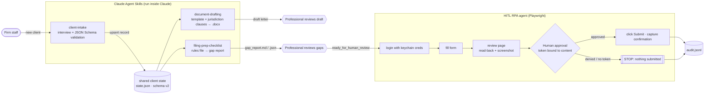

# claude-skills-hitl-automation

[](https://github.com/Juankia/claude-skills-hitl-automation/actions/workflows/ci.yml)
[](LICENSE)


**Claude Agent Skills for a professional-services back office, plus a Playwright RPA agent that will not take an irreversible action until a human approves it.**

Law, accounting and advisory firms handle the same chain of work over and over: take in a new client, draft the engagement letter, assemble a filing packet, submit it on a portal. Language models handle the conversational parts well. They should not decide on their own whether a document is valid or whether a filing gets submitted. This repository splits the work along that line:

- **Claude** interviews, explains and drafts.
- **Deterministic scripts** validate, render and check against versioned rules and schemas.
- **A human** approves anything that cannot be undone.

All names, firms, courts and data in this repository are fictional.

---

## What's inside

| Component | What it does | Tech |
| --- | --- | --- |
| [`skills/client-intake`](skills/client-intake/SKILL.md) | Structured intake interview → normalized, JSON Schema-validated client record → shared state | Python, `jsonschema` |
| [`skills/document-drafting`](skills/document-drafting/SKILL.md) | Engagement letter from a template with jurisdiction-specific clauses → **byte-for-byte reproducible** `.docx` | Python, `python-docx` |
| [`skills/filing-prep-checklist`](skills/filing-prep-checklist/SKILL.md) | Checks a packet against a configurable rules file (fields, required docs, naming, page/size limits, PDF encryption/OCR, intake & conflict status) → gap report. **Never submits.** | Python, `pypdf` |
| [`shared/client_state.py`](shared/client_state.py) | Versioned JSON store shared by all skills: atomic writes, schema migrations, OS-correct paths on macOS/Windows/Linux | stdlib only |
| [`rpa/`](rpa) | Playwright agent that fills a portal form, stops at the review page, shows a summary + screenshot and **requires explicit approval** before clicking Submit | TypeScript, Playwright, `keytar` |
| [`rpa/demo-portal`](rpa/demo-portal) | Local Express "e-filing portal" the agent and the tests run against | Express |

## How it flows



## Principle: human-in-the-loop for irreversible actions

Anything an automation can undo, it may do on its own. Anything it cannot undo (filing with a court, sending to a client, paying, deleting) needs a person to approve the **exact** action. In this repository:

1. **The skills never act outward.** `filing-prep-checklist` reports `ready_for_human_review`, never "ready to file". Drafts carry a "FIRST DRAFT" document property and highlight `[[MISSING]]`/`[[REVIEW]]` markers.
2. **The RPA agent pauses before Submit.** It reaches the portal's review page, reads back what the portal will actually send, compares that with the intended data (and aborts on any mismatch), takes a screenshot and asks for approval.
3. **Approval is tied to the content.** The approval token is a SHA-256 hash of the reviewed summary. A token issued for one filing cannot approve a different or edited one. At the interactive prompt, typing `y` does nothing; the operator has to type the token.
4. **Two layers of enforcement.** Besides the control-flow gate, a Playwright network route aborts every request to the submission endpoint until approval. A stray click, a retry bug or a misbehaving script still cannot file anything, and a test checks this.
5. **No answer means no.** A closed stdin, a non-TTY run (CI, cron, an LLM tool call) or a missing token all count as a denial. A non-interactive run exits with code `3` and prints the token a human can use to approve.
6. **Everything leaves a trail.** `audit.jsonl` records start, the summary awaiting approval, the decision and the confirmation, and never the password.

## Quick start

```bash
git clone https://github.com/Juankia/claude-skills-hitl-automation.git
cd claude-skills-hitl-automation

# Python skills
python -m venv .venv && source .venv/bin/activate   # Windows: .venv\Scripts\activate
pip install -r requirements-dev.txt
pytest

# RPA agent
cd rpa
npm ci
npx playwright install chromium
npm test
```

### Run the whole chain by hand

```bash
export CLIENT_SKILLS_HOME=$PWD/.client-skills   # keep demo state inside the repo (git-ignored)

# 1. Intake → shared state
python skills/client-intake/scripts/validate_intake.py skills/client-intake/templates/intake_answers.example.json
python shared/client_state.py list               # copy the client_id

# 2. Draft the engagement letter
python skills/document-drafting/scripts/draft_document.py --client-id <client_id>

# 3. Build a demo packet (add --broken to see gaps) and check it
python examples/make_demo_packet.py out/packet --client-id <client_id>
python skills/filing-prep-checklist/scripts/check_packet.py out/packet

# 4. Submit through the human gate
cd rpa
npm run portal &                                  # demo portal on http://127.0.0.1:4317
export PORTAL_USERNAME=demo.filer PORTAL_PASSWORD=demo-only-password   # demo-only credentials
npm run agent -- --filing examples/filing.json --checklist ../out/packet/gap_report.json
# → prints the summary + screenshot path, asks for the token (or exits 3 when non-interactive)
npm run agent -- --filing examples/filing.json --approve-token <token>
```

> **Demo GIF:** a recording of step 4 (agent pausing on the review page, then approval) will go here: `docs/demo.gif`.

## What are Agent Skills?

[Agent Skills](https://docs.anthropic.com/en/docs/agents-and-tools/agent-skills/overview) are folders that teach Claude a repeatable procedure. Each one has a `SKILL.md` with YAML frontmatter (`name`, `description`) plus optional scripts, templates and reference files. Claude loads only the name and description until a task matches, then reads the instructions and runs the bundled scripts as needed. This keeps context small and puts the work that has to be exact in code.

```
skills/client-intake/
├── SKILL.md                         # frontmatter + workflow Claude follows
├── scripts/validate_intake.py       # deterministic validation + persistence
├── schemas/client_record.schema.json
├── references/questionnaire.md      # loaded only when needed
└── templates/intake_answers.example.json
```

### Install in Claude Code

```bash
python scripts/install_skills.py                    # personal: ~/.claude/skills/<skill>
python scripts/install_skills.py --project ../my-repo   # project: ../my-repo/.claude/skills
```

The installer copies each skill and adds `shared/client_state.py` to the skill's `scripts/` directory, so every installed skill is self-contained. (A test runs an installed skill with `python -I` to confirm this.) Restart Claude Code and ask, for example, *"Open a new client for Brightwater Ceramics"*.

### Install in Claude.ai

```bash
python scripts/install_skills.py --zip dist/
```

Upload each `dist/<skill>.zip` under **Settings → Capabilities → Skills**. Code execution must be enabled for the bundled scripts to run.

## Security notes

- **Credentials never reach the model.** The RPA agent reads them from the OS keychain (macOS Keychain, Windows Credential Manager, libsecret) through [`keytar`](https://github.com/atom/node-keytar). It falls back to `PORTAL_USERNAME`/`PORTAL_PASSWORD` for CI. The password only goes into the browser's password field. It is not logged, not written to the audit trail, not included in summaries and not returned to the caller.
  ```bash
  cd rpa && npm run creds:set -- --account demo.filer   # hidden prompt, stored in the keychain
  ```
- `keytar` is an **optional** native dependency. If it cannot load (locked keychain, headless CI), the agent quietly falls back to environment variables.
- **No secrets in the repo.** The only credential is the throwaway password for the local demo portal, and it is documented as such.
- **The skills work only on local files.** Manifest paths that resolve outside the packet folder (`../escape.pdf`) are rejected.
- **State writes are atomic** (temp file + `os.replace`), so a crash cannot leave a half-written client store. Files from a newer schema version are refused rather than misread.
- The jurisdiction clauses are **illustrative sample language, not legal advice**. Every draft must be reviewed by a licensed professional.

## Tests

| Suite | Count | Covers |
| --- | --- | --- |
| `pytest` | 44 | state store (paths per OS, migrations, atomicity), intake normalization & schema/business rules, template engine, reproducible `.docx`, jurisdiction fallback, every packet check, CLI exit codes, installer & SKILL.md frontmatter |
| Playwright | 19 | gate blocks without approval, wrong token, human denial, token bound to content, matching token submits exactly once, network guard stops a rogue click, bad login, input validation, prompt (`y` rejected, EOF = deny), keychain → env fallback, CLI exit codes, checklist gate |

CI runs the Python suite on Ubuntu, macOS and Windows, and the Playwright suite against the demo portal with Chromium.

## Project layout

```
.
├── skills/
│   ├── client-intake/           SKILL.md · scripts/ · schemas/ · references/ · templates/
│   ├── document-drafting/       SKILL.md · scripts/ · templates/ · references/jurisdictions.json
│   └── filing-prep-checklist/   SKILL.md · scripts/ · rules/default_rules.json · templates/
├── shared/client_state.py       versioned JSON state store (stdlib only)
├── scripts/install_skills.py    install to ~/.claude/skills or zip for Claude.ai
├── examples/make_demo_packet.py fictional packet generator (hand-written PDFs)
├── rpa/
│   ├── src/                     agent.ts · approval.ts · credentials.ts · cli.ts · store-credentials.ts
│   ├── demo-portal/             Express server + static portal UI
│   └── tests/                   Playwright specs
├── tests/                       pytest suite
└── .github/workflows/ci.yml
```

## Roadmap

- [ ] Wrap the skills as an MCP server so other agents can call intake, drafting and checks as tools
- [ ] Approval via Slack/Teams interactive message (same content-bound token) in addition to the CLI
- [ ] Signed approval records (HMAC with a per-operator key) for stronger non-repudiation
- [ ] Per-court rule packs and a `rules lint` command
- [ ] PDF/A and embedded-font checks; automatic OCR suggestion for scanned exhibits
- [ ] `.docx` diff report between template versions
- [ ] Record the demo GIF

## About the author

**Juan Carlos Amay**, AI Architect & Senior Full Stack Engineer, based in Ecuador. I build production Claude Skills, MCP servers and Playwright RPA agents with human-in-the-loop controls for regulated US businesses.

- GitHub: [@Juankia](https://github.com/Juankia)
- LinkedIn: [juancarlosamayizquierdo](https://linkedin.com/in/juancarlosamayizquierdo)

## License

[MIT](LICENSE) © 2026 Juan Carlos Amay
